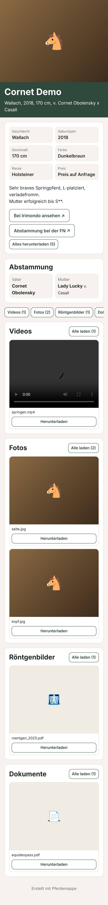
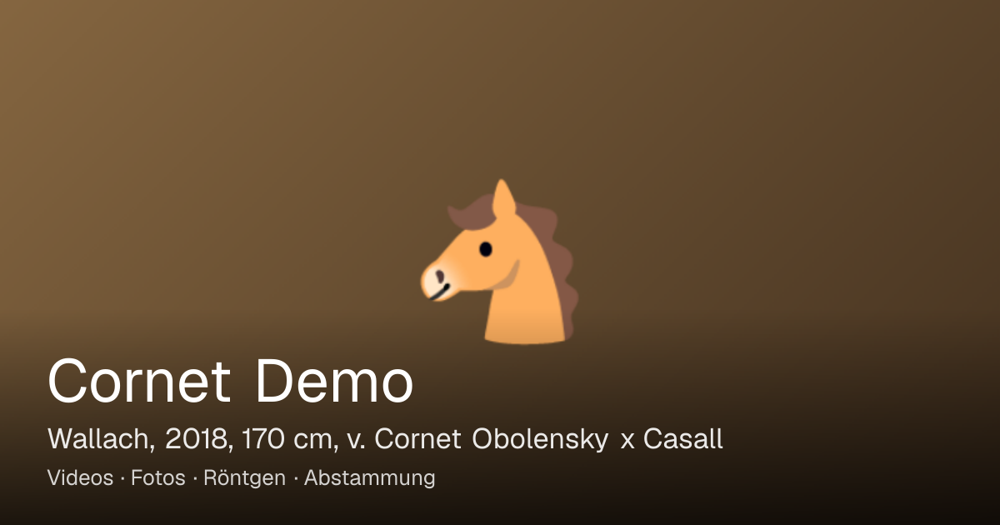

# 🐴 Horsebox – Grundskelett

**Ein Pferd. Ein Link. Alles drin.**
Der Verkäufer legt ein Pferd einmal an (Name, Abstammung, Links zu Rimondo und FN) und lädt Videos,
Fotos, Röntgenbilder und Dokumente per Drag & Drop hoch. Danach schickt er dem Kunden nur noch
**einen Link per WhatsApp**. Der Kunde sieht alles auf einer Seite, kann Videos direkt abspielen und
alles einzeln oder komplett herunterladen.

| Kundenansicht auf dem Handy | Vorschau in WhatsApp |
|---|---|
|  |  |

(Die Bilder oben sind mit Testdaten erstellt.)

---

## Was schon funktioniert

- **Konto anlegen / anmelden** für Verkäufer (E-Mail + Passwort)
- **Meine Pferde**: Übersicht aller eigenen Pferde
- **Pferd anlegen und bearbeiten**: Name, Geburtsjahr, Geschlecht, Stockmaß, Farbe, Rasse, Vater, Mutter,
  Muttervater, Beschreibung, Preis, Link zu Rimondo, Link zur FN
- **Upload per Drag & Drop** in vier Kategorien: Videos, Fotos, Röntgenbilder, Dokumente.
  Mit Fortschrittsbalken, mehrere Dateien gleichzeitig, auch große Videos.
- **Teilen**: Knopf „Per WhatsApp senden“, „Link kopieren“ und das Teilen-Menü des Handys
- **Kundenseite** `/p/<name-xxxxxx>`: ohne Login, auf dem Handy gut lesbar, Videos abspielen,
  Fotos ansehen, Einzel-Download, „Alle laden“ pro Kategorie und „Alles herunterladen“
- **Schöne Link-Vorschau** in WhatsApp (erstes Foto + Name + Abstammung)
- **Verkäufer-Profil** (`/dashboard/profil`): Name, Stall, Ort, Handynummer. Auf der Kundenseite erscheint
  ein Kasten „Verkäufer“ mit „Per WhatsApp fragen“ (Nachricht mit Pferdename und Link ist schon vorausgefüllt) und „Anrufen“.
- **Reihenfolge und Titelbild**: Mit ◀ ▶ die Reihenfolge ändern, mit „★ Titelbild“ das große Foto für
  Kundenseite und WhatsApp-Vorschau festlegen.
- Link kann pro Pferd **deaktiviert** werden. Kundenseiten erscheinen **nicht bei Google**.
- Der Link enthält einen Zufallsteil (z. B. `cornet-k3x9qa`), damit niemand fremde Pferde erraten kann.

---

## Design wählen

Es gibt drei Designs. Umschalten mit der Einstellung `NEXT_PUBLIC_DESIGN` (in `.env.local` oder bei Vercel unter
Environment Variables, danach neu deployen):

| Wert | Aussehen |
|---|---|
| `stall` | Klassisch: Dunkelgrün, Beige, Gold (Standard) |
| `sport` | Modern & hell: Marineblau, Orange |
| `premium` | Dunkel & edel: Schwarz, Gold, Überschriften mit Serifenschrift |

Die Farben stehen oben in `app/globals.css`, die Namen in `lib/design.ts`.

---

## Wie es aufgebaut ist (Architektur)

```
 Handy/PC des Verkäufers                     Handy des Kunden
        │                                           │
        ▼                                           ▼
 ┌──────────────────────────────────────────────────────────┐
 │  Next.js Web-App  (läuft später bei Vercel)              │
 │  - Seiten: Login, Meine Pferde, Pferd bearbeiten         │
 │  - Kundenseite /p/...  + WhatsApp-Vorschaubild           │
 │  - erstellt einmalige Upload-/Download-Links             │
 └──────────────┬───────────────────────────────────────────┘
                │
                ▼
 ┌──────────────────────────────────────────────────────────┐
 │  Supabase                                                │
 │  - Login (Auth)                                          │
 │  - Datenbank: Tabellen "horses" und "media"              │
 │  - Speicher (Storage): Bucket "horse-media" (privat)     │
 └──────────────────────────────────────────────────────────┘
```

**Warum schnell?** Dateien gehen **direkt** vom Browser in den Speicher und zurück, nicht über
unseren Server. Unser Server stellt nur einen einmaligen, zeitlich begrenzten Link aus
(„signierte URL“). Dadurch gibt es kein Nadelöhr, auch nicht bei großen Videos.

**Warum diese Werkzeuge?**
- **Next.js** (React): eine Codebasis für Webseite, Handy-Ansicht und spätere „App zum Installieren“ (PWA).
  Sehr verbreitet, einfach bei Vercel zu veröffentlichen.
- **Supabase**: Login, Datenbank und Dateispeicher aus einer Hand, mit einem Konto.
  Kostenlos zum Starten, später günstig skalierbar.

**Wichtige Dateien**

| Datei / Ordner | Was drin ist |
|---|---|
| `supabase/schema.sql` | Datenbank-Tabellen, Zugriffsregeln, Speicher-Bucket. Einmal in Supabase ausführen. |
| `app/dashboard/` | Verkäufer-Bereich (Liste, Anlegen, Bearbeiten, Upload) |
| `app/dashboard/[id]/MediaSection.tsx` | Drag & Drop Upload |
| `app/p/[slug]/page.tsx` | Kundenseite |
| `app/p/[slug]/opengraph-image.tsx` | Vorschaubild für WhatsApp |
| `app/api/upload-url` und `app/api/media` | Upload-Links erstellen, Dateien eintragen/löschen |
| `lib/types.ts` | Kategorien (Videos, Fotos …). Hier kann man neue Kategorien ergänzen. |
| `app/globals.css` | Farben und Aussehen |

---

## Wo muss ich weitermachen? (Schritt für Schritt)

### 1. Supabase-Konto und Projekt anlegen (ca. 10 Minuten)
1. Auf **https://supabase.com** registrieren und **„New project“** anlegen.
   Region: **Frankfurt (eu-central-1)**, wegen Datenschutz und Geschwindigkeit in Deutschland.
2. Links im Menü **SQL Editor** → **New query** → den kompletten Inhalt von `supabase/schema.sql`
   hineinkopieren → **Run**. Damit sind Tabellen, Regeln und der Speicher angelegt.
3. **Project Settings → API** öffnen. Dort stehen die drei Werte, die du gleich brauchst:
   Project URL, `anon`/`publishable` Key und `service_role`/`secret` Key.
4. Optional für den Anfang: **Authentication → Sign In / Providers → Email** → „Confirm email“
   ausschalten, dann muss man beim Registrieren keine Bestätigungs-Mail abwarten.

> ⚠️ **Wichtig zu großen Videos:** Im kostenlosen Supabase-Tarif ist eine einzelne Datei auf
> **50 MB** begrenzt. Handyvideos sind oft größer. Mit dem **Pro-Tarif (ca. 25 $/Monat)** kann man
> unter **Storage → Settings** das Limit z. B. auf 5 GB stellen. Für erste Tests reichen kurze Videos.

### 2. App auf dem eigenen Rechner starten (optional, zum Ausprobieren)
Voraussetzung: **Node.js** (Version 20 oder neuer) von https://nodejs.org installieren.
```bash
npm install
cp .env.example .env.local      # dann .env.local öffnen und die drei Supabase-Werte eintragen
npm run dev
```
Dann im Browser **http://localhost:3000** öffnen, Konto anlegen, erstes Pferd anlegen.

### 3. Code auf GitHub
Damit Vercel die App veröffentlichen kann, muss der Code in einem GitHub-Repository liegen.
Leg auf github.com ein **leeres, privates Repository** an (z. B. `horsebox`). Claude kann den Code
dann dorthin hochladen, oder du lädst den Ordner selbst hoch.

### 4. Online stellen mit Vercel (ca. 10 Minuten)
1. Auf **https://vercel.com** mit dem GitHub-Konto anmelden → **Add New → Project** → Repository wählen.
2. Unter **Environment Variables** die vier Werte aus `.env.example` eintragen:
   - `NEXT_PUBLIC_SUPABASE_URL`
   - `NEXT_PUBLIC_SUPABASE_ANON_KEY`
   - `SUPABASE_SERVICE_ROLE_KEY` (geheim!)
   - `NEXT_PUBLIC_SITE_URL` = die spätere Adresse, z. B. `https://horsebox.vercel.app`
3. **Deploy** klicken. Nach 1–2 Minuten ist die App online.
4. Wenn du Werte änderst: in Vercel **neu deployen** (die Werte werden beim Bauen eingesetzt).
5. Eigene Domain (z. B. `pferde.deinname.de`): in Vercel unter **Settings → Domains**, danach
   `NEXT_PUBLIC_SITE_URL` anpassen und in Supabase unter **Authentication → URL Configuration** die
   Site URL eintragen.

### 5. Ausprobieren
Pferd anlegen → Videos/Fotos reinziehen → „Per WhatsApp senden“ an dich selbst schicken →
prüfen, ob Vorschau, Abspielen und Download auf dem Handy gut funktionieren.

---

## Nächste Features (Vorschläge, nach Wichtigkeit)

1. **Logo im Verkäufer-Profil** (das Profil selbst mit WhatsApp-Knopf ist fertig).
2. ~~Reihenfolge und Titelbild~~ ✓ erledigt (Pfeil-Knöpfe ◀ ▶ und „★ Titelbild“ bei jeder Datei).
3. **Alles als ZIP herunterladen** (statt vieler Einzel-Downloads, wichtig fürs iPhone).
4. **Video-Vorschaubilder und kleinere Fotos** für schnelleres Laden (z. B. mit Supabase
   Image Transformations oder Cloudflare Stream / Mux für Videos).
5. **Fortsetzbarer Upload** für sehr große Videos bei schlechtem Netz (Supabase unterstützt „TUS“).
6. **Statistik**: Wie oft wurde der Link geöffnet, welche Dateien wurden geladen?
7. **Mehrere Links pro Pferd** (z. B. einer ohne Röntgenbilder) oder Link mit Ablaufdatum.
8. **PWA**: App auf dem Handy-Homescreen installieren (Grundlage `app/manifest.ts` ist schon da).
9. **Kosten bei vielen Downloads**: Wenn sehr viel heruntergeladen wird, kann man den Speicher
   auf **Cloudflare R2** umstellen (keine Gebühren für Downloads). Betroffen wären nur
   `app/api/upload-url/route.ts` und `lib/signed-urls.ts`.

### Später: Medien per WhatsApp an ein Pferd schicken (nur Skizze, noch nicht gebaut)
So könnte es funktionieren:
1. Eine eigene WhatsApp-Business-Nummer über die **WhatsApp Business Platform (Meta Cloud API)**
   oder einen Anbieter wie Twilio / 360dialog einrichten. Das braucht ein verifiziertes
   Meta-Business-Konto und kostet pro Gespräch ein paar Cent.
2. Verkäufer hinterlegt seine Handynummer im Profil.
3. Er schickt an die Nummer z. B. `#cornet` und danach seine Videos und Fotos.
4. Ein neuer Endpunkt `app/api/whatsapp/route.ts` empfängt die Nachrichten (Webhook), erkennt die
   Nummer und das Pferd, lädt die Medien von WhatsApp herunter und legt sie in die passende Kategorie
   (Bild → Fotos, Video → Videos, PDF → Dokumente).
5. Antwort per WhatsApp: „3 Videos zu Cornet hinzugefügt ✓ Link: …“

Hinweis: WhatsApp verkleinert Videos und Fotos beim Senden. Für beste Qualität ist der Upload über
die Web-Seite besser. Darum erst bauen, wenn der normale Upload im Alltag zu umständlich ist.

---

## Sicherheit in Kürze
- Jeder Verkäufer sieht und ändert nur **seine eigenen** Pferde (Regeln direkt in der Datenbank).
- Dateien liegen in einem **privaten** Speicher. Kunden bekommen nur Links, die nach 6 Stunden
  ablaufen. Lädt der Kunde die Seite neu, gibt es frische Links.
- Der `service_role` Schlüssel ist geheim: nie weitergeben, nie in GitHub hochladen
  (`.env.local` ist darum in `.gitignore` ausgeschlossen).
- Röntgenbilder sind Gesundheitsdaten des Pferdes, nicht von Personen. Trotzdem: Impressum und
  Datenschutzerklärung ergänzen, bevor fremde Verkäufer die Plattform nutzen.

## Befehle
| Befehl | Was er macht |
|---|---|
| `npm install` | Einmalig: benötigte Pakete laden |
| `npm run dev` | App lokal starten (http://localhost:3000) |
| `npm run build` | Prüfen, ob alles fehlerfrei gebaut werden kann |
| `npm run typecheck` | Code auf Tippfehler prüfen |
